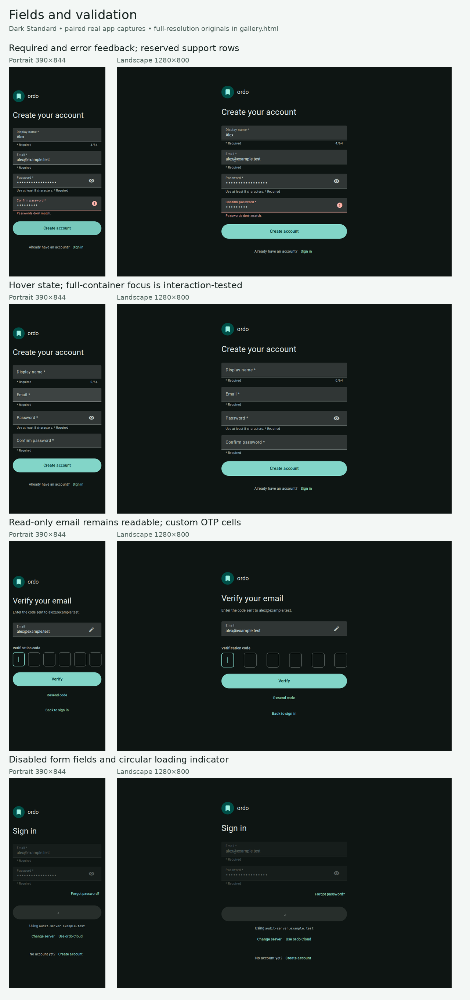
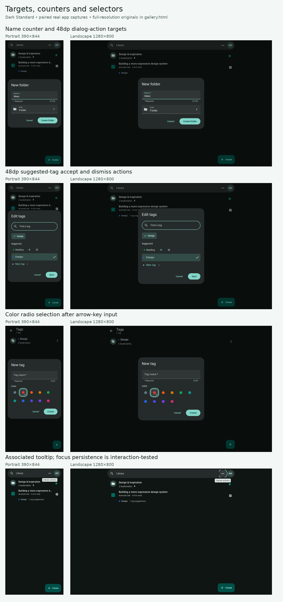
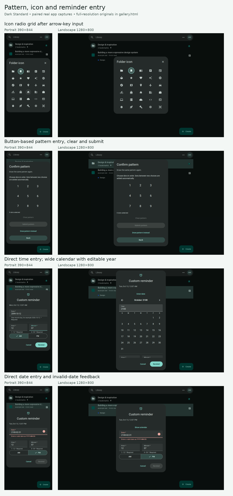
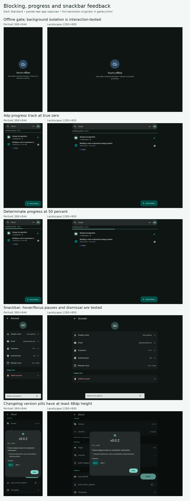

# Material audit fix evidence

**[Download the complete screenshot gallery](https://raw.githubusercontent.com/axoletlabs/ordo/material-3-redesign/docs/material-audit/gallery.html)**

Save the link as `gallery.html`, then open it in a browser. GitHub's file page
does not render HTML. The saved gallery works offline: all **412 screenshots**
are embedded at their original resolution, with theme/design/layout filters,
state search, full-size viewing, and individual PNG downloads. No temporary
server paths or connected Review pane are needed.

The gallery includes:

- **20** original targeted captures, across light/dark and Standard/Expressive.
- **124** additional field, selector, picker, tooltip, offline, and progress
  captures, including matching 390×844 and 1280×800 states.
- **32** additional suggested-tag, tooltip, snackbar, and changelog captures.
- **236** broader regression captures. These include unchanged surfaces; they
  are not 236 newly fixed components.

Some states are captured in multiple runs. These are capture counts, not
counts of unique components or unique tests. The manifest records original
names, source runs, dimensions, and SHA-256 checksums.

## What changed

| Category | Fixes applied |
| --- | --- |
| Fields | Separate hover, focus, disabled, and read-only states; padding clicks focus the editor; disabled accessories do not activate. Normal fields remain 56dp high. |
| Validation | Required/invalid/description semantics, required indicators, alert errors and error icons, reserved supporting rows, and validated name-limit counters. Custom OTP/PIN cells gain disabled/error semantics. |
| Targets | Actual 48dp action areas for buttons, icon buttons, segments, interactive chips, suggested-tag actions, and changelog version pills. Smaller visuals can remain inside the larger targets. |
| Pattern entry | An alternative ordered-dot button interface, clear and submit, retaining the existing skip-fill algorithm and credential format. |
| Date/time | Direct hour and arbitrary 0–59 minute entry; locale/OS hour cycle; calendar/date-input switching, editable year, and calendar keyboard navigation. |
| Selectors | Named icon/color radio groups, checked state, roving tab stops and arrow navigation; selectable chips distinguish selection from actions. |
| Tooltips | Trigger association, persistent hover/focus visibility, pointer transfer, and Escape dismissal. Native long-press tooltips remain transient. |
| Progress/motion | Shared 4dp progress track, truthful zero fill and numeric values; circular arcs grow/shrink; reduced-motion preferences update live. |
| Offline gate | Web focus containment, hidden/inert background, and restoration after reconnect. Native modal accessibility declarations are retained. |
| Buttons/menus | Added outlined button API, Standard small-button 24dp padding, Standard action-group pressed-width expansion, and Standard menu-item spacing. No current screen uses the new outlined variant, so no shipped-screen image is claimed for it. |
| Snackbars | Pause timeout during hover/focus and consult Android's recommended accessible timeout. |

### Measured before → after

All four light/dark × Standard/Expressive combinations:

- Design chip active area: **56×24 → 56×48dp**.
- Library icon active area: **40×40 → 48×48dp**.
- Cancel active height: **40 → 48dp**; wrapper-padding clicks now activate.
- Hover/padding focus and folder-icon arrow navigation: **0/4 → 4/4 passing**.
- Offline background isolation: **0/4 → 4/4 passing**, with reconnect restoration.
- Progress: **3dp/fake minimum fill → 4dp/true zero**, numeric **0 → 50%** verified.

## Screenshot overviews

Each overview pairs dark Standard portrait and landscape captures. Full-size
originals, Expressive variants, and light-theme variants are in the gallery.
The overview images are scaled composites; no app content has been redrawn.

### Fields and validation

### Targets, counters, selectors, and tooltips

### Pattern, icon, and reminder entry

### Offline gate, progress, snackbars, and changelog targets

## Evidence and limitations

The additional capture runs passed **156 captures, 9 interaction scenarios,
zero page errors**. The snackbar run also verified persistence beyond its
ordinary 4-second timeout while hovered and while focused, plus explicit
dismissal. Target measurements verified the suggested-tag actions and changelog
version pills. Companion `*-results.json` files retain the original run records.

Screenshots cannot demonstrate invisible interaction bounds, keyboard behavior,
timeout pausing, live motion response, or accessibility-tree isolation on their
own. Those claims come from interaction assertions, not the appearance of a PNG.

These runs use the previously verified web export and mocked APIs, not production
backend data. Native TalkBack/VoiceOver, IME/autofill, physical hit-testing,
Android's recommended timeout, and large OS fonts remain on-device checks.
Reading the actual OS 12/24-hour toggle requires a native build containing
`expo-localization`; older APKs use the locale fallback. The local ARM host's
x86-64 Hermes compiler still blocks production bytecode verification. No APK,
deployment, native accessibility certification, or complete all-state Material
conformance is claimed.

Implementation and reproduction commands:
[`apps/mobile/tests/material-audit-fixes.md`](../../apps/mobile/tests/material-audit-fixes.md).
